# 🖥️ Awesome Server Monitoring & Infrastructure Management

  
  
  
  
  
  

> 📊 A comprehensive, SEO-optimized curated list of top **Server Monitoring**, **Infrastructure Management**, and **Cloud Observability** platforms — featuring SaaS solutions sorted by company valuation and battle-tested open-source alternatives sorted by GitHub stars.
>
> 🌟 **Star this repository if you find it helpful for your DevOps and SysAdmin stacks!** 🌟

---

## 📋 Table of Contents

- [📈 Sector Overview & Market Dynamics](#-sector-overview--market-dynamics)
- [🟦 SaaS / Hosted Platforms](#-saas--hosted-platforms)
- [🟩 Open-Source Software](#-open-source-software)
  - [🟢 Uptime Kuma](#-uptime-kuma)
  - [⚡ Netdata](#-netdata)
  - [📊 Grafana](#-grafana)
  - [🔥 Prometheus](#-prometheus)
  - [🔍 Glances](#-glances)
  - [🔎 SigNoz](#-signoz)
  - [🚀 VictoriaMetrics](#-victoriametrics)
  - [🛡️ Zabbix](#-zabbix)
  - [⚙️ Checkmk](#-checkmk)
  - [🚨 Icinga 2](#-icinga-2)
  - [🏛️ Munin](#-munin)
  - [📡 Nagios Core](#-nagios-core)
- [📊 Comparison at a Glance](#-comparison-at-a-glance)
- [🤝 Contributing](#-contributing)
- [💖 Support](#-support)
- [⭐ Star History](#-star-history)
- [📄 License](#-license)

---

## 📈 Sector Overview & Market Dynamics

The global server monitoring and IT infrastructure management market is estimated at **$18.5 Billion** and is projected to surpass **$45.8 Billion by 2032**, expanding at a Compound Annual Growth Rate (**CAGR**) of **10.6% to 12.2%**. Driven by exponential multi-cloud container sprawl, distributed microservices, edge computing, and hybrid enterprise fleets, continuous infrastructure observability and automated anomaly remediation have transitioned from operational support utilities to mission-critical resilience backbones.

The industry exhibits a **moderately fragmented and hybrid market structure**. Foundational enterprise accounts are dominated by massive full-stack observability and IT service management conglomerates (such as Datadog, Cisco AppDynamics, Dynatrace, New Relic, and SolarWinds), yet no single vendor monopolizes the sector. Concurrently, a vibrant ecosystem of specialized SaaS players (Site24x7, LogicMonitor, Paessler PRTG) and hyper-popular open-source technologies (Prometheus, Grafana, Netdata, Uptime Kuma, and SigNoz) thrive vigorously, serving modern cloud-native architectures, on-premises data centers, and privacy-conscious engineering organizations.

---

## 🟦 SaaS / Hosted Platforms

Commercial, managed cloud-native Server Monitoring and Infrastructure Management platforms. The table below is sorted by **Company Scale (Valuation / Market Capitalization / ARR, descending)** and highlights starting tier pricing alongside specific free tier limits.

| Product / Platform | Company | Scale (Valuation / Revenue) | Starting Pricing (Specific Tier) | Free Tier / Free Trial Limits | Key Capabilities |
| :--- | :--- | :--- | :--- | :--- | :--- |
| **Datadog** | 🏢 Datadog, Inc. (NASDAQ: DDOG) | **$42.8B+ Market Cap** ($2.6B+ ARR) | **$15/host/month** (Pro Plan, billed annually) | **14-Day Free Trial** with full infrastructure, APM, and log monitoring access | Full-stack infrastructure observability, 750+ turn-key integrations, real-time metrics, anomaly detection & distributed tracing. |
| **Dynatrace** | 🏢 Dynatrace, Inc. (NYSE: DT) | **$16.2B+ Market Cap** ($1.5B+ ARR) | **$0.08/hour per 8 GiB host** (~$58.40/month for Infrastructure Monitoring) | **15-Day Free Trial** with full automated discovery and Davis AI root-cause analysis | AI-driven full-stack observability (Davis AI engine), automatic topology mapping, hybrid-cloud & Kubernetes monitoring. |
| **SolarWinds SAM** | 🏢 SolarWinds Corp (NYSE: SWI) | **$2.1B+ Market Cap** ($780M+ ARR) | **$1,813 perpetual license** (or starting from **$176/month** subscription) | **30-Day Free Trial** with unrestricted server and application dependency mapping | Deep multi-vendor on-premise and hybrid server health, hardware monitoring, storage arrays, Active Directory & IIS monitoring. |
| **New Relic** | 🏢 New Relic (Francisco Partners / TPG) | **$6.5B Private Valuation** ($950M+ ARR) | **$0.35/GB ingested** (Standard Tier) + $49/month per core compute user | **Free Forever Tier:** 100 GB/month data ingest + 1 free full-platform user forever | Full-stack telemetry ingest engine, APM, infrastructure metrics, automated error tracking & applied intelligence. |
| **Site24x7** | 🏢 Zoho Corporation | **$1.2B+ Revenue (Zoho Corp)** | **$9/month** (Starter Plan, billed annually for up to 10 servers/websites) | **Free Forever Plan** (monitors up to 5 servers/URLs with 10-minute poll frequency) + **30-Day Free Trial** for Pro | All-in-one IT infrastructure monitoring suite, global synthetic uptime nodes (130+ locations), network SNMP & APM. |
| **LogicMonitor** | 🏢 Vista Equity Partners | **$2.4B Private Valuation** ($250M+ ARR) | **$22/device/month** (Core Infrastructure Pro Tier, minimum commitment applies) | **14-Day Free Trial** with automated cloud resource discovery and out-of-the-box dashboards | Agentless hybrid cloud monitoring, automated topology discovery, enterprise forecasting, and predictive alerting. |
| **PRTG Network Monitor** | 🏢 Paessler AG | **$150M+ Valuation** (~$65M Annual Revenue) | **$2,149 perpetual license** (PRTG 500 tier, up to 500 monitoring sensors) | **Free Forever Plan** (up to 100 sensors free forever after 30-day unrestricted trial) | Comprehensive network, server, and bandwidth monitoring using native SNMP, WMI, flow protocols, and packet sniffing. |

---

## 🟩 Open-Source Software

Self-hosted, community-driven, and enterprise-grade open-source Server Monitoring and Infrastructure Management systems. Sorted by **GitHub Star Count (descending)**.

---

### 🟢 Uptime Kuma
  
**Stack:** Node.js / Vue.js / SQLite | **License:** MIT | **Repository:** [louislam/uptime-kuma](https://github.com/louislam/uptime-kuma)  
Uptime Kuma is a self-hosted monitoring tool offering responsive HTTP(s), TCP, DNS, and ping monitoring alongside status pages. It features an intuitive web UI, certificate expiry tracking, and native integrations with 90+ notification channels (Telegram, Discord, Slack, email, Webhooks).  
🎯 **Best for:** Lightweight server availability tracking, uptime checks, and public status pages.

---

### ⚡ Netdata
  
**Stack:** C / Go / Python | **License:** GPL-3.0 | **Repository:** [netdata/netdata](https://github.com/netdata/netdata)  
Netdata delivers real-time, per-second performance troubleshooting and infrastructure telemetry with zero configuration. It collects thousands of system and container metrics with ultra-low CPU and memory footprints, providing ML-based anomaly detection out of the box.  
🎯 **Best for:** Instant per-second node diagnostics, edge device observability, and real-time server troubleshooting.

---

### 📊 Grafana
  
**Stack:** TypeScript / Go | **License:** AGPL-3.0 | **Repository:** [grafana/grafana](https://github.com/grafana/grafana)  
Grafana is the world's most widely adopted open-source visualization and dashboarding engine for operational metrics. It connects seamlessly to dozens of storage backends including Prometheus, Graphite, InfluxDB, Elasticsearch, and relational databases.  
🎯 **Best for:** Enterprise monitoring dashboards, unified metric visualization, and cross-source telemetry exploration.

---

### 🔥 Prometheus
  
**Stack:** Go | **License:** Apache-2.0 | **Repository:** [prometheus/prometheus](https://github.com/prometheus/prometheus)  
Prometheus is a CNCF-graduated open-source monitoring and alerting toolkit built for dynamic cloud-native environments. It utilizes a pull-based HTTP metric scraping model, a local time-series database (TSDB), dynamic service discovery, and PromQL.  
🎯 **Best for:** Cloud-native Kubernetes monitoring, dynamic service discovery, and metric alerting.

---

### 🔍 Glances
  
**Stack:** Python | **License:** LGPL-3.0 | **Repository:** [nicolargo/glances](https://github.com/nicolargo/glances)  
Glances is an open-source system monitoring tool that presents extensive host resource utilization data via a curses terminal interface, web UI, or REST API. It tracks CPU, memory, load averages, process lists, network I/O, disk partitions, and Docker containers.  
🎯 **Best for:** Quick single-node CLI/web system monitoring, Docker host inspection, and minimal resource profiling.

---

### 🔎 SigNoz
  
**Stack:** Go / TypeScript / ClickHouse | **License:** MIT | **Repository:** [SigNoz/signoz](https://github.com/SigNoz/signoz)  
SigNoz is an open-source full-stack observability platform natively engineered on OpenTelemetry and ClickHouse. It combines application metrics, distributed distributed traces, and log aggregation into a single unified web console as an open alternative to Datadog.  
🎯 **Best for:** Unified traces, metrics, and logs with OpenTelemetry standardization without commercial SaaS lock-in.

---

### 🚀 VictoriaMetrics
  
**Stack:** Go | **License:** Apache-2.0 | **Repository:** [VictoriaMetrics/VictoriaMetrics](https://github.com/VictoriaMetrics/VictoriaMetrics)  
VictoriaMetrics is a fast, cost-effective, and scalable time-series database and monitoring solution. Built as a drop-in replacement for Prometheus and InfluxDB, it delivers up to 10x compression, low memory utilization, and native PromQL/MetricsQL compatibility.  
🎯 **Best for:** High-cardinality long-term metrics storage, massive-scale monitoring clusters, and low-cost Prometheus federation.

---

### 🛡️ Zabbix
  
**Stack:** C / PHP / PostgreSQL / MySQL | **License:** AGPL-3.0 | **Repository:** [zabbix/zabbix](https://github.com/zabbix/zabbix)  
Zabbix is an enterprise-grade distributed monitoring solution designed to monitor millions of metrics from servers, virtual machines, network devices, and cloud applications. It supports native agents as well as agentless SNMP, IPMI, and JMX monitoring with auto-discovery.  
🎯 **Best for:** Large enterprise infrastructure, multi-vendor network hardware, and centralized on-premise data centers.

---

### ⚙️ Checkmk
  
**Stack:** C++ / Python | **License:** GPL-2.0 | **Repository:** [checkmk/checkmk](https://github.com/checkmk/checkmk)  
Checkmk is an infrastructure and application monitoring platform that combines Nagios compatibility with a modern high-performance micro-core engine. It delivers automated configuration discovery, 2,000+ official plugins, and granular host telemetry.  
🎯 **Best for:** High-density enterprise infrastructure monitoring requiring rapid auto-discovery and pre-packaged plug-and-play checks.

---

### 🚨 Icinga 2
  
**Stack:** C++ | **License:** GPL-2.0 | **Repository:** [icinga/icinga2](https://github.com/icinga/icinga2)  
Icinga 2 is a multi-threaded, scalable open-source monitoring system designed to monitor entire network fabrics, cloud environments, and server fleets. It provides a flexible configuration language, native cluster capabilities, and clean REST APIs.  
🎯 **Best for:** Scalable multi-zone distributed monitoring, complex alerting rule chains, and modern Nagios modernization.

---

### 🏛️ Munin
  
  
**Stack:** Perl / RRDtool | **License:** GPL-2.0 | **Repository:** [munin-monitoring/munin](https://github.com/munin-monitoring/munin)  
Munin is a networked resource monitoring tool that surveys host parameters and generates historical graphs over time using RRDtool. With a plug-and-play architecture, it provides an unpretentious way to analyze server resource consumption patterns.  
🎯 **Best for:** Lightweight historical resource graphing, simple Linux server fleet health, and low-overhead tracking.

---

### 📡 Nagios Core
  
**Stack:** C | **License:** GPL-2.0 | **Repository:** [NagiosEnterprises/nagioscore](https://github.com/NagiosEnterprises/nagioscore)  
Nagios Core is an industry-standard IT monitoring foundation powering server, network, and application surveillance worldwide. Its modular plugin architecture enables custom checks written in any scripting language with battle-tested alert escalations.  
🎯 **Best for:** Traditional IT operations, custom script checks, and mission-critical server availability alerting.

---

## 📊 Comparison at a Glance

| Software | License | Primary Stack | Architecture Pattern | Real-Time Granularity | SNMP / Hardware Support | Cloud-Native / K8s | Best For |
| :--- | :--- | :--- | :--- | :--- | :--- | :--- | :--- |
| **Uptime Kuma** | MIT | Node.js / SQLite | Centralized Ping/HTTP Probe | Interval-Based (20s-60s) | ❌ No | ✅ Docker / Standalone | Uptime tracking & public status pages |
| **Netdata** | GPL-3.0 | C / Go | Distributed Agent + Streaming | ✅ Per-Second (1s) | ✅ Via Plugins | ✅ Helm / DaemonSet | Real-time troubleshooting & edge nodes |
| **Grafana** | AGPL-3.0 | TypeScript / Go | Centralized Visualizer | Depends on Data Source | (Via Data Sources) | ✅ Native Cloud Engine | Unified multi-source metric dashboards |
| **Prometheus** | Apache-2.0 | Go | Pull-Based Scraping TSDB | Configurable (1s-15s) | Via SNMP Exporter | ✅ Standard De-Facto K8s | Kubernetes & cloud-native service discovery |
| **Glances** | LGPL-3.0 | Python | Single-Host Agent / Curses / API | ✅ Real-Time (2s) | ❌ No | ✅ Docker Container | Single-node CLI / web host inspection |
| **SigNoz** | MIT | Go / ClickHouse | OpenTelemetry Native Collector | Configurable Streams | Via OTel Collector | ✅ Kubernetes / Helm | Unified traces, metrics, logs in one UI |
| **VictoriaMetrics** | Apache-2.0 | Go | High-Compression Time-Series | Sub-Second Ingestion | Via Prometheus Exporters | ✅ K8s Operator / Cloud | High-scale long-term TSDB storage |
| **Zabbix** | AGPL-3.0 | C / PHP / DB | Server-Agent + Active Proxies | Configurable Polling | ✅ Native SNMP/IPMI/JMX | Hybrid / On-Premise Focus | Enterprise multi-protocol & network monitoring |
| **Checkmk** | GPL-2.0 | C++ / Python | Hybrid Agent + Check Engine | High-Frequency Polling | ✅ 2,000+ Built-in Checks | Hybrid / Cloud / Appliance | Auto-discovery for complex enterprise fleets |
| **Icinga 2** | GPL-2.0 | C++ | Distributed Multi-Zone Engine | Schedule-Driven | ✅ Native SNMP Plugin Support | Hybrid / Containerized | Complex alerting rules & multi-zone clusters |
| **Munin** | GPL-2.0 | Perl / RRDtool | Master-Node Poller (RRD) | 5-Minute Cron Cycles | Via Plugins | Legacy / Bare-Metal | Historical resource utilization graphs |
| **Nagios Core** | GPL-2.0 | C | Scheduler + Forked Plugins | Interval-Based Checks | ✅ Extensive Plugin Network | Legacy / Hybrid | Battle-tested custom script alerting |

---

## 🤝 Contributing

Contributions are warmly welcome! If you maintain or use a noteworthy Server Monitoring or Infrastructure Management tool that should be included in this curated directory:

1. 🍴 Fork the repository.
2. 🌿 Create a descriptive branch: `git checkout -b feature/add-new-tool`.
3. 📝 Add your tool with official links, supported tech stack, license, GitHub star badge, and clear architectural use cases.
4. 🚀 Submit a Pull Request with a summary of the additions.

---

## 💖 Support

If this repository assisted you in evaluating, designing, or upgrading your infrastructure monitoring infrastructure:

- ⭐ **Star this repository** to improve visibility and help other DevOps engineers!
- 🍴 **Fork the project** and adapt it for your team's internal tooling radar.
- 📢 **Share with the community** on LinkedIn, Reddit, or DevOps user groups.
- ☕ **Support the maintainer:** Visit the [GitHub Sponsors Dashboard](https://github.com/sponsors/ishandutta2007) to back open-source curation!

---

## ⭐ Star History

---

## 📄 License

This curated directory is released under the [CC0 1.0 Universal (Public Domain)](http://creativecommons.org/publicdomain/zero/1.0/) license. Individual software platforms, logos, and projects referenced remain copyrighted by their respective owners and vendors.

---

⭐ <b>Engineered for DevOps Engineers, SREs, and System Administrators. Star this repository to support future updates!</b> ⭐

